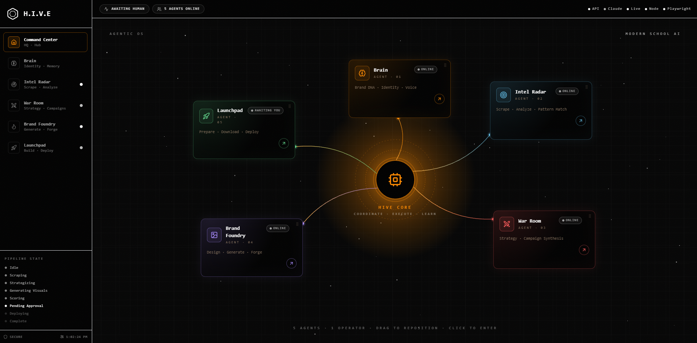

<p align="center">
  
</p>

<h1 align="center">H.I.V.E <span></span></h1>

<p align="center">
  An autonomous, <b>local-first</b> marketing orchestrator.<br/>
  One operator. Five agents. One state file.
</p>

<p align="center">
  <sub>Next.js dashboard · Node + Playwright engine · Claude Code CLI (OAuth) · Apify scraping · Higgsfield MCP · Jev virality scoring</sub>
</p>

---

## What it does

Given a short brand profile and a few competitor URLs, H.I.V.E:

1. **Scrapes** competitor ads from Meta Ad Library + Google Ads Transparency Center
2. **Analyzes** them for winning patterns, competitive gaps, and visual language
3. **Synthesizes** a campaign strategy (hook, pillars, 5-slide carousel outline, 3 single-ad variants) using Claude
4. **Writes** a per-platform ad-spend playbook grounded in the real competitor data
5. **Generates** finished creative — HTML+CSS slides rendered to 1080×1350 PNG via Playwright, or photo-grade image ads via Higgsfield
6. **Scores** every creative with Jev (virality + market fit + craft) — real API or deterministic mock
7. **Approves** via a human-in-the-loop UI with inline AI edits
8. **Deploys** — one-click download + pre-filled captions + composer deep links for Instagram, LinkedIn, X, Meta Ads Manager, Google Ads

Everything persists in a single JSON file (`agentic-os/tasks.json`). No database. No API keys needed for Claude (uses your local OAuth session).

---

## Quick start

```bash
cd agentic-os
npm install
npx playwright install chromium
npm install -g @anthropic-ai/claude-code && claude login
cp .env.local.example .env.local      # add APIFY_TOKEN + TYPESAFE_API_KEY=mock
npm run dev                           # → http://localhost:3000
```

The dashboard opens on the Command Center hub (shown above). Click any agent to enter.

---

## The 5 agents

| # | Agent | Does |
|---|---|---|
| 01 | **Brain** | Brand identity — business, voice, tone, differentiators, do-not-say list |
| 02 | **Intel Radar** | Competitor target URLs, scrape launcher, scraped-ad review |
| 03 | **War Room** | Claude-synthesized strategy + AD BUDGET STRATEGY panel (Meta/Google/Experimental split with creative playbook) |
| 04 | **Brand Foundry** | Edit the carousel outline + ad concepts, forge PNGs, mix HTML renders with Higgsfield images |
| 05 | **Launchpad** | Preview, score with Jev, approve, download, deploy to IG / LinkedIn / X / Meta Ads / Google Ads |

Plus the **Command Center** hub (hero image above) — 3D radial layout with draggable agent cards, live status chips, pulsing active-agent connectors, and progressive unlock based on pipeline state.

---

## Pipeline

```
idle → scraping → strategizing → generating_visuals → scoring → pending_approval → deploying → complete
```

Every transition is a `status` write to `tasks.json`. The UI polls at 1–2s so engine progress reflects live.

---

## Full documentation

See **[agentic-os/README.md](agentic-os/README.md)** for the detailed engineering docs:

- Project structure (every file explained)
- Architecture (3 layers: UI / API routes / engine subprocesses)
- `tasks.json` schema
- How carousels are generated (end-to-end)
- How single ads are generated
- How Claude is connected (OAuth, no API key, `claude -p` subprocess pattern)
- How Apify is used (token, actors, cost per ad)
- How Higgsfield MCP is used
- War Room → Ad Budget Strategy → Foundry handoff
- Jev scoring (real + mock) and the market-summary pipeline
- Install, scripts, troubleshooting, design principles

---

## Tech stack

**Frontend:** Next.js 14 (App Router) · React 18 · TypeScript (strict) · Tailwind CSS · Lucide icons · CSS 3D transforms
**Backend engine:** Node.js subprocesses · Playwright (headless Chromium) · Apify REST · Claude Code CLI (OAuth) · Higgsfield MCP · TypeSafe Jev
**Persistence:** One JSON file. No database. No ORM. No state manager.

---

<p align="center">
  <sub>Built with Claude Code. Autonomous. Local. Operator-approved.</sub>
</p>
